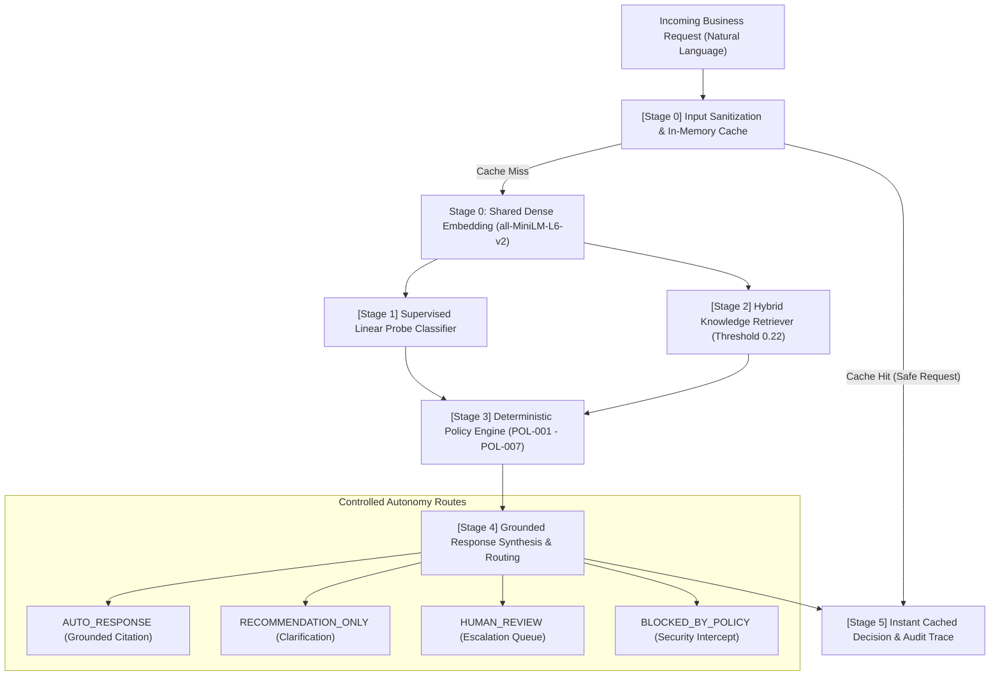

# DecisionForge AI — Architecture Specification

## 1. System Overview

DecisionForge AI is an intelligent, multi-stage business request decision and routing engine. It acts as a controlled-autonomy decision-support system for incoming customer support tickets and operational business inquiries, enforcing enterprise compliance through deterministic guardrails and source-grounded evidence retrieval.

---

## 2. Multi-Stage Pipeline Architecture

---

## 3. Stage-by-Stage Component Breakdown

### Stage 0: Input Sanitization & Cache Check
- **Normalization:** Strips extraneous whitespace, normalizes Unicode characters, and generates an MD5/SHA-256 cache key.
- **In-Memory Cache (R5):** Evaluates whether an identical or normalized safe request was recently resolved.
- **Latency Impact:** Delivers **2.008 ms mean latency** (and sub-0.04 ms median responses), providing a **5.48x speedup**.
- **Security Control:** Requests resulting in `BLOCKED_BY_POLICY` or ambiguous clarification states are never cached.

### Stage 1: Supervised Intent Classification (Approach A)
- **Model:** Logistic Regression linear probe (`C=5.0`, `class_weight="balanced"`) on 384-dimensional dense sentence embeddings (`all-MiniLM-L6-v2`) with a TF-IDF N-gram fallback.
- **Output:** Predicted intent category (from 9 classes) + continuous probability distribution + confidence score.
- **Compute Efficiency:** Reuses the dense query representation computed in Stage 0, adding < 0.1 ms classification overhead.

### Stage 2: Hybrid Knowledge Retrieval (Approach B)
- **Corpus:** 12 enterprise policy documents in `data/knowledge_base.json`.
- **Hybrid Scoring:** $0.70 \times \text{Semantic Cosine} + 0.30 \times \text{Keyword Overlap} + 0.05 \times \text{Category Bonus}$.
- **Relevance Thresholding:** Minimum similarity floor of `0.22`. Irrelevant queries return zero documents, preventing hallucinated citations.

### Stage 3: Deterministic Policy & Safety Guardrails
- **Immutable Override:** Independent of classifier confidence, hardcoded compliance rules intercept violations:
  - `POL-001`: Intercepts prompt injections, jailbreaks, and system override attempts.
  - `POL-002`: Blocks prohibited financial ledger modifications, force approvals, and direct payouts.
  - `POL-003`: Identifies ambiguous, short (< 10 chars), or underspecified requests.
  - `POL-004`: Routes complaints and legal threats directly to human supervisors.
  - `POL-005`: Escalates queries with classification confidence `< 0.60`.
  - `POL-006`: Escalates queries lacking verified knowledge grounding (top score `< 0.22`).
  - `POL-007`: Dispatches verified automated response citing exact document excerpts.

### Stage 4: Grounded Response Synthesis
- Formulates user-facing answers strictly grounded in retrieved document excerpts (`DOC-ACC-001`, etc.).
- Categorizes final decision status into `AUTO_RESPONSE`, `RECOMMENDATION_ONLY`, `HUMAN_REVIEW`, or `BLOCKED_BY_POLICY`.

### Stage 5: Structured Observability Trace
- Every decision emits a complete JSON audit trace:
  - `request_id`, `timestamp` (UTC)
  - `predicted_category`, full `class_probabilities` dictionary
  - `retrieved_sources` with document titles, IDs, and similarity scores
  - `policy_checks_passed` and `policy_checks_blocked` lists
  - `decision_status`, `recommended_action`, and `escalation_reason`
  - `processing_route`, `latency_ms`, and `cache_hit` flag

---

## 4. Controlled Autonomy & Safety Boundaries
- **100% Synthetic Data:** All customer records and policies are synthetic simulations.
- **Zero Real-World Actions:** The engine cannot trigger real financial disbursements or credential alterations.
- **Deterministic Veto:** Machine learning recommendations can be rejected by the policy engine; the policy engine can never be overridden by machine learning predictions.
